# SomaClima

App Android de clima **100% offline**, feito para o trabalho *Somativa N2* da disciplina de Desenvolvimento de App Android Moderno (PUCPR).

O app não acessa a rede: o clima é **simulado** por uma função matemática determinística, as cidades são validadas contra um catálogo local e as escolhas do usuário ficam salvas em um banco Room.

**Stack:** Kotlin · Jetpack Compose (Material 3) · MVVM · Room (SQLite) · Hilt · Navigation Compose

## Telas

| Home | Seletor de cidade | Previsão |
| :---: | :---: | :---: |
| 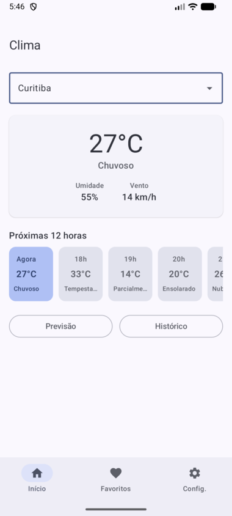 | 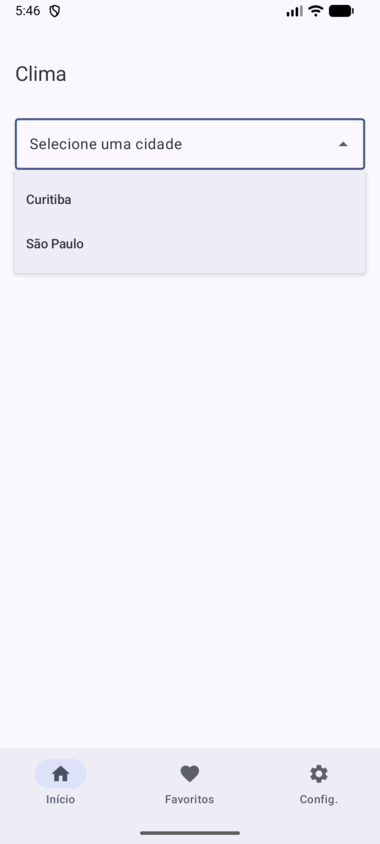 | 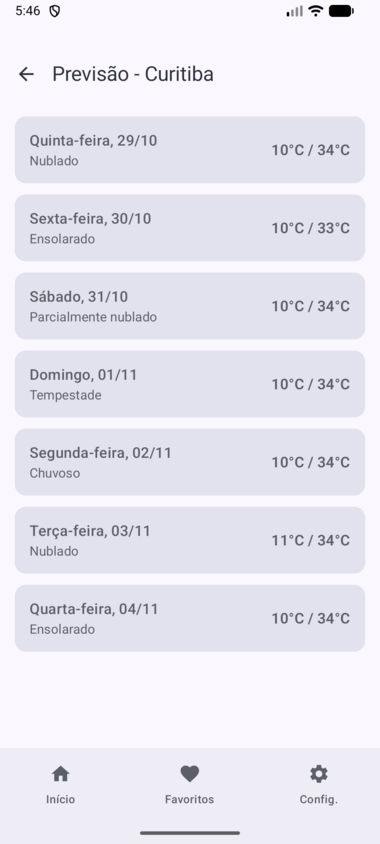 |

| Histórico — meses | Histórico — dias | Histórico — horas |
| :---: | :---: | :---: |
| 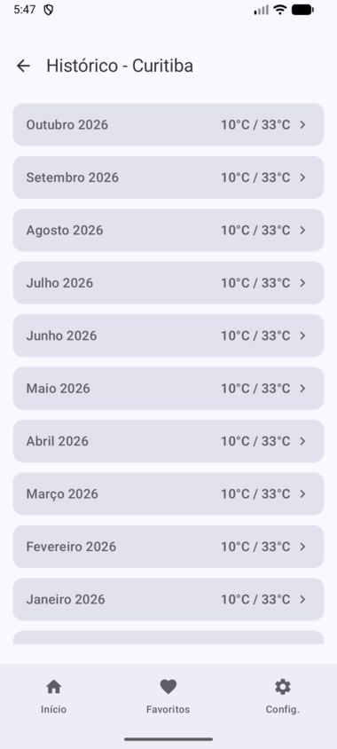 | 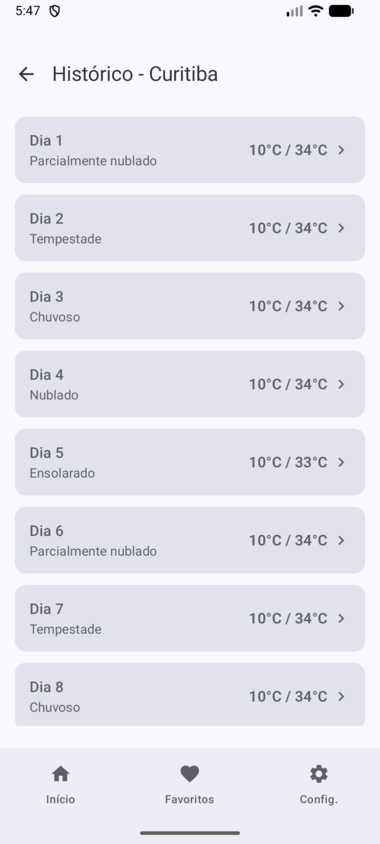 | 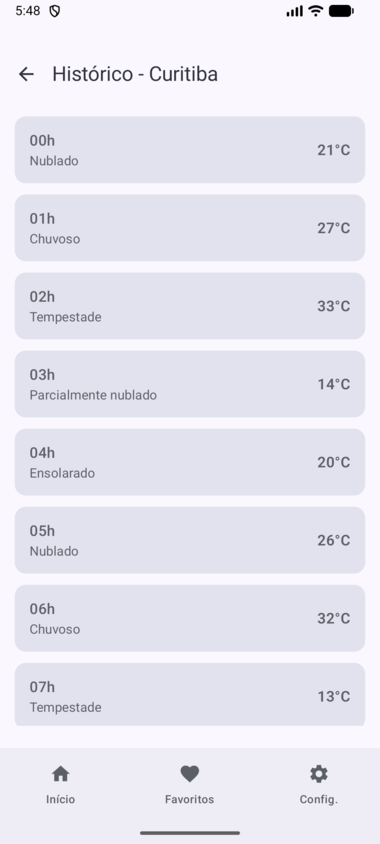 |

| Favoritos | Adicionar cidade | Configurações |
| :---: | :---: | :---: |
| 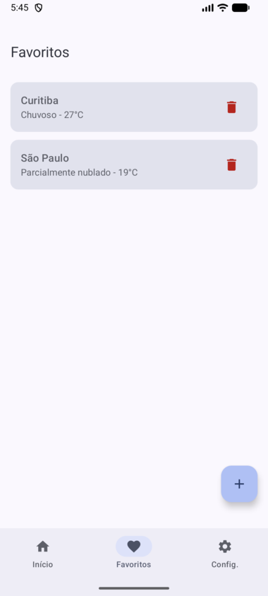 | 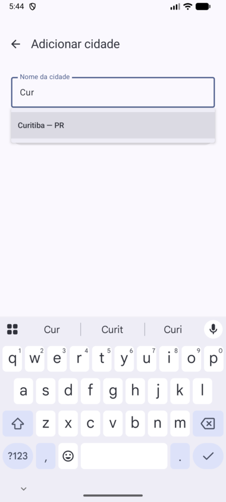 | 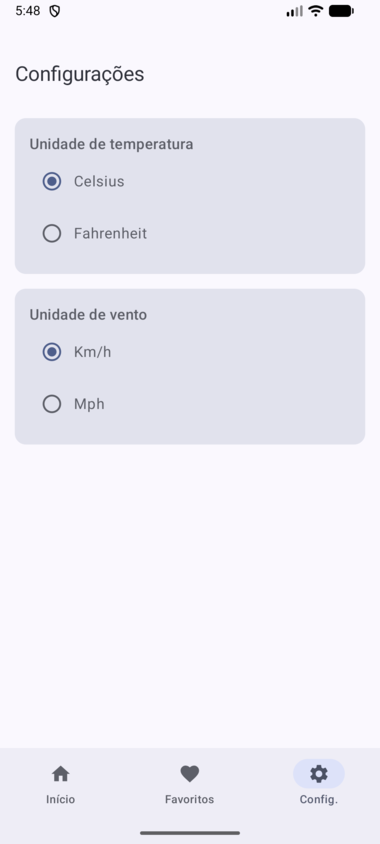 |

| Tela | O que faz | Dados |
| --- | --- | --- |
| **Home** | Seletor da cidade atual (só lista as favoritas), clima "agora" em destaque e as próximas 12 horas. Botões levam à Previsão e ao Histórico. | `listarCidades()`, `observarCidadeAtual()`, `gerarClimaAtual()`, `gerarHorasApartirDe()` |
| **Previsão** | Um resumo por dia para os próximos 7 dias: dia/data, condição predominante e mín/máx. | `gerarProximosDias(nome, 7)` |
| **Histórico** | Navegação em 3 níveis: 12 meses → dias do mês → 24 horas do dia. O botão voltar sobe um nível por vez. | `gerarUltimosMeses()`, `gerarDiasDoMes()`, `gerarHorasDoDia()` |
| **Favoritos** | Lista e remove cidades (com confirmação). O FAB `+` é o único caminho para adicionar. | `listarCidades()`, `removerCidade()` |
| **Adicionar cidade** | Autocomplete sobre o catálogo offline; o botão só habilita depois de escolher uma sugestão. Rejeita duplicatas. | `buscarNoCatalogo()`, `adicionarCidade()` |
| **Configurações** | Temperatura em °C/°F e vento em km/h/mph. A troca é instantânea e global. | `salvarUnidadeTemperatura()`, `salvarUnidadeVento()` |

## Como executar

Pré-requisitos: Android Studio recente (o projeto usa AGP 9.3 e `compileSdk` 37) e JDK 11+.

1. Abra a pasta do projeto no Android Studio e aguarde o sync do Gradle.
2. Selecione um emulador ou dispositivo (API 24+).
3. Execute o módulo `app`.

Ou, pela linha de comando:

```bash
./gradlew assembleDebug      # gera o APK de debug
./gradlew installDebug       # instala no dispositivo/emulador conectado
./gradlew test               # testes unitários
```

Configuração principal: `minSdk` 24, `targetSdk` 37, pacote `com.example.somativan2`.

## Arquitetura

O projeto segue **MVVM** em quatro camadas. A seta sempre aponta para "quem sabe menos": a UI não sabe que existe Room, e o Room não sabe que existe Compose.

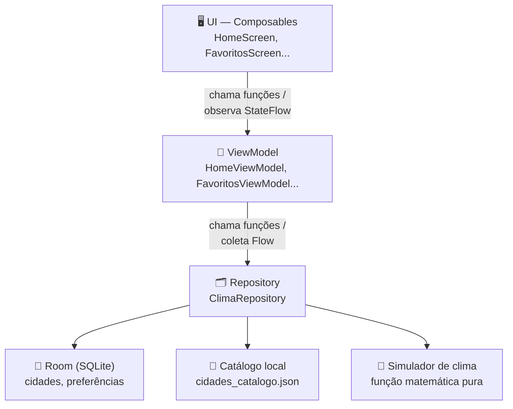

| Camada | Pergunta que responde | Exemplo |
| --- | --- | --- |
| UI (Compose) | O que a pessoa está vendo e tocando agora? | `HomeScreen.kt` |
| ViewModel | Que estado essa tela precisa para se desenhar? | `HomeViewModel.kt` |
| Repository | De onde vêm os dados, e como escondo isso da tela? | `ClimaRepository.kt` |
| Fontes de dados | Como eu de fato leio/escrevo/calculo isso? | `CidadeDao`, `SimuladorClima` |

ViewModels e telas dependem apenas da **interface** `ClimaRepository`, nunca de `ClimaRepositoryImpl`. Trocar a origem dos dados (por exemplo, do simulador local para uma API) exige alterar só a implementação.

### Fluxo reativo: trocar de cidade na Home

Ninguém chama "atualizar tela" manualmente. O `HomeViewModel` usa `combine()` para escutar três fluxos ao mesmo tempo (favoritas, cidade atual, preferências) e recalcula o estado inteiro sempre que qualquer um muda. O Compose observa o `StateFlow` e recompõe sozinho.

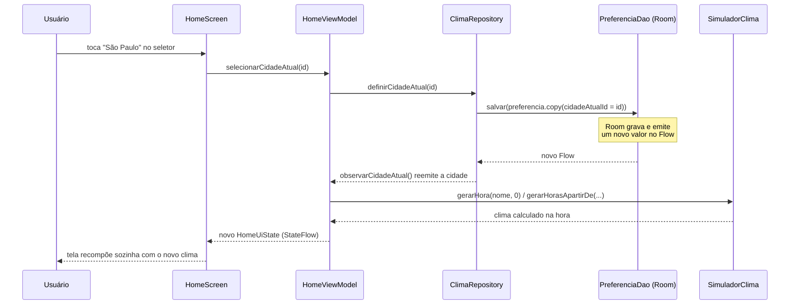

```kotlin
// HomeViewModel.kt
init {
    viewModelScope.launch {
        combine(
            repository.listarCidades(),
            repository.observarCidadeAtual(),
            repository.observarPreferencia()
        ) { favoritas, cidadeAtual, preferencia ->
            // roda de novo sempre que QUALQUER um dos 3 mudar
            val clima = cidadeAtual?.let { repository.gerarClimaAtual(it.nome) }
            HomeUiState(favoritas = favoritas, cidadeAtual = cidadeAtual, clima = clima, /* ... */)
        }.collect { novoEstado -> _uiState.value = novoEstado }
    }
}
```

## Estrutura de pastas

```
app/src/main/
├── assets/cidades_catalogo.json     # ~260 cidades reais (catálogo offline)
└── java/com/example/somativan2/
    ├── MainActivity.kt
    ├── SomaClimaApplication.kt      # @HiltAndroidApp
    ├── data/
    │   ├── model/                   # ClimaHora, ResumoDia, ResumoMes (só dados)
    │   ├── simulador/               # SimuladorClima, ConversorUnidades, FormatadorTempo
    │   ├── catalogo/                # CidadeCatalogo + leitura do JSON local
    │   ├── local/                   # Room: entidades, DAOs, AppDatabase
    │   └── repository/              # ClimaRepository (interface) + Impl
    ├── di/                          # Módulos Hilt: DatabaseModule, RepositoryModule
    └── ui/
        ├── screens/<tela>/          # uma pasta por tela: Screen.kt + ViewModel.kt
        ├── components/              # ChipHora, CidadeItemCard, SeletorCidadeAtual, TopBarSimples
        ├── navigation/              # Rotas.kt e AppNavHost.kt
        └── theme/                   # Color, Theme, Type
```

## Injeção de dependência (Hilt)

Dois módulos montam a árvore de objetos, sem construção manual de dependências. Cada ViewModel só declara `@Inject constructor(private val repository: ClimaRepository)`.

```kotlin
// di/RepositoryModule.kt
@Module
@InstallIn(SingletonComponent::class)
abstract class RepositoryModule {
    @Binds @Singleton
    abstract fun bindClimaRepository(impl: ClimaRepositoryImpl): ClimaRepository
}
```

`DatabaseModule` fornece (`@Provides`) o `AppDatabase` e os DAOs.

## Banco de dados (Room)

Duas tabelas: cidades favoritas e preferências do usuário.

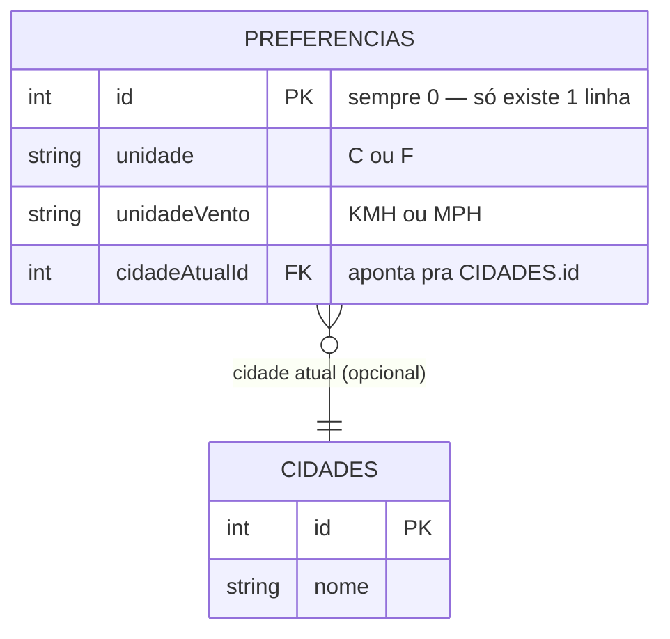

- `PREFERENCIAS` tem sempre uma única linha (`id` fixo = 0), então ler/gravar preferências não depende de consulta por usuário.
- `CIDADES` não tem coluna `favorito`: a única forma de uma cidade entrar na tabela é pela tela *Adicionar cidade*, então toda linha já é uma favorita. Remover é um `DELETE` direto.
- Os DAOs retornam `Flow<List<CidadeEntity>>`: o Room reemite a lista a cada mudança, sem recarregar manualmente.

## Clima simulado

O nome da cidade combinado a um deslocamento de tempo vira um número determinístico (hash), usado para escolher temperatura, umidade, vento e condição.

```kotlin
// data/simulador/SimuladorClima.kt
private fun semente(nome: String, offset: Long): Long {
    val base = nome.trim().lowercase().hashCode().toLong()
    return kotlin.math.abs(base + offset * 31L)
}

fun gerarHora(nome: String, offsetHoras: Long): ClimaHora {
    val semente = semente(nome, offsetHoras)
    return ClimaHora(
        temperatura = (10 + (semente % 25)).toInt(),      // 10°C a 34°C
        umidade     = (30 + (semente / 7 % 60)).toInt(),   // 30% a 89%
        vento       = (2 + (semente / 13 % 40)).toInt(),   // 2 a 41 km/h
        condicao    = condicoes[(semente % condicoes.size).toInt()],
        timestampOffsetHoras = offsetHoras
    )
}
```

A função é **pura**: o resultado depende só de `nome` + `offset`, nunca do relógio do sistema. Por isso não é preciso gravar 8760 horas de "histórico de 1 ano" no banco: cada tela calcula só a fatia que está exibindo, na hora.

| Tela | Chamada |
| --- | --- |
| Home (agora) | `gerarHora(nome, 0)` |
| Próximas 12h | `gerarHorasApartirDe(nome, 0, 12)` |
| Previsão (7 dias) | `gerarProximosDias(nome, 7)` — agrega 24 horas por dia |
| Histórico (1 ano) | `gerarUltimosMeses` → `gerarDiasDoMes` → `gerarHorasDoDia`, sempre sob demanda |

**Validação de cidades:** `assets/cidades_catalogo.json` guarda ~260 cidades reais (capitais brasileiras, grandes municípios e capitais mundiais). `CidadeCatalogoLocal` lê o arquivo uma vez com `org.json` (já incluso no Android, zero dependências novas) e responde "quais cidades batem com o que foi digitado?" (autocomplete, ignora acentos e maiúsculas) e "esse nome exato existe?" (validação ao salvar).

## Navegação

Três telas ficam numa barra inferior fixa (trocar de aba não empilha histórico); as outras três empilham por cima, com seta de voltar.

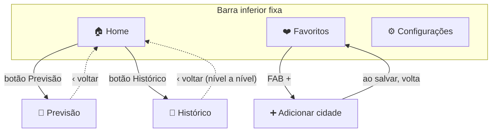

- As 6 rotas são constantes de texto em `ui/navigation/Rotas.kt`. Nenhuma recebe parâmetro: Previsão e Histórico sempre refletem a cidade atual salva.
- O voltar do Histórico sobe um nível por vez (horas → dias → meses) via `voltarNivel()`, que retorna `true` enquanto ainda há nível para subir e `false` quando deve ocorrer a navegação real (`popBackStack()`).
